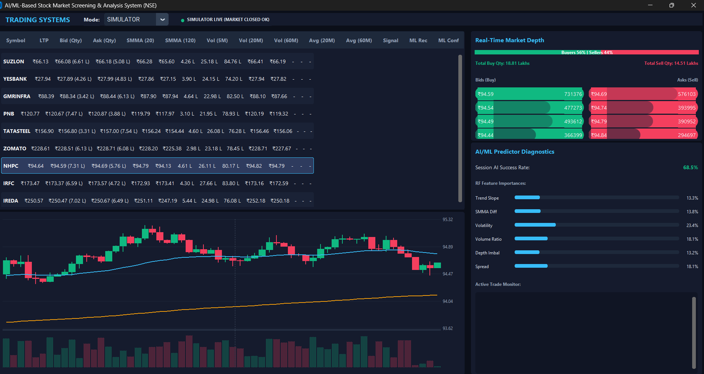

#  Stock Market Screening and Analysis System

##  Overview

The **AI/ML-Based Stock Market Screening and Analysis System** is a real-time Python application designed to screen NSE-listed stocks, analyze live market conditions, calculate technical indicators, and use Machine Learning to evaluate the reliability of SMMA crossover signals.

The system continuously streams live market data using the **Fyers API v3**, filters stocks based on liquidity and price conditions, computes technical indicators on a **1-minute timeframe**, and applies an AI/ML model to predict whether a detected Buy or Sell crossover is likely to succeed or fail.

Unlike traditional screeners that simply generate crossover signals, this application attempts to identify **false signals**, estimate the **probability of success**, and provide an explanation for why a particular trade should be avoided.



---

#  Features

## Real-Time Stock Screening

The application continuously scans all **NSE-listed stocks** and filters stocks whose:

- Last Traded Price (LTP) is between **₹30 and ₹500**

This ensures that only actively tradable mid-range stocks are considered.

---

## Liquidity Filtering

After price filtering, stocks are further filtered based on market depth.

Conditions:

- Bid Quantity > **10,00,000**
- Ask Quantity > **10,00,000**

Only highly liquid stocks are analyzed.

---

## Technical Indicator Calculation

For every filtered stock, the application calculates:

- SMMA (20)
- SMMA (120)

using **1-minute historical candle data** obtained from Fyers API.

The system continuously monitors both moving averages to detect crossover events.

---

## Exchange Traded Quantity Analysis

The application calculates the total traded quantity during:

- Last 5 Minutes
- Last 20 Minutes
- Last 60 Minutes

These values help identify sudden increases in participation before taking a trade.

---

## Average Price Analysis

Average Last Traded Price (LTP) is calculated for:

- Last 20 Minutes
- Last 60 Minutes

This provides a quick understanding of price trend and mean value.

---

## Live Market Depth

The dashboard displays live Level-1 market depth information including:

- Bid Price
- Bid Quantity
- Ask Price
- Ask Quantity

This information is refreshed automatically using live market data.

---

## Real-Time Dashboard

All processed information is displayed in a continuously updating dashboard.

Each row represents one stock and includes:

- Stock Symbol
- LTP
- SMMA (20)
- SMMA (120)
- Bid Price
- Ask Price
- Bid Quantity
- Ask Quantity
- Quantity (5 Min)
- Quantity (20 Min)
- Quantity (60 Min)
- Average Price (20 Min)
- Average Price (60 Min)
- AI Signal
- Confidence Score
- Trade Recommendation

---

#  AI / Machine Learning Analysis

The major objective of this project is **not simply generating crossover signals**, but determining whether those signals should actually be traded.

The AI engine analyzes multiple market characteristics before approving or rejecting a signal.

### Features Used

The model evaluates:

- SMMA 20
- SMMA 120
- Distance between both averages
- Bid Quantity
- Ask Quantity
- Market Depth
- Recent Volume
- Exchange Traded Quantity
- Price Momentum
- Average Price
- Historical Crossover Performance
- Trend Strength
- Volatility

---

## Buy Signal

Generated when:

```
SMMA (20) crosses above SMMA (120)
```

The AI predicts:

- Probability of success
- Expected trend continuation
- Whether to take or avoid the trade

---

## Sell Signal

Generated when:

```
SMMA (20) crosses below SMMA (120)
```

The AI evaluates whether the bearish crossover is likely to continue.

---

## AI Decision Output

Instead of simply displaying:

```
BUY
```

the application displays something similar to:

| Signal | Confidence | Decision |
|----------|------------|----------|
| BUY | 91% | ACCEPT |
| SELL | 87% | ACCEPT |
| BUY | 38% | REJECT |

---

## Trade Rejection Explanation

If the AI predicts a poor-quality signal, the dashboard provides an explanation such as:

- Low trading volume
- Weak liquidity
- Sideways market
- Weak crossover angle
- High volatility
- Fake breakout
- Insufficient momentum
- Bid/Ask imbalance
- Low confidence prediction

Example:

```
BUY Signal Rejected

Reason:

• Weak upward momentum
• Low traded quantity
• High volatility
• Historical probability only 34%
```

---

#  Fyers API Integration

This project uses **Fyers API v3** as the primary source of real-time market data.

The API provides:

### Live Market Quotes

- Last Traded Price (LTP)
- Bid Price
- Ask Price
- Bid Quantity
- Ask Quantity

---

### Historical Candles

Used for:

- SMMA (20)
- SMMA (120)
- Average Price
- Volume Analysis

---

### Market Depth

Used to retrieve:

- Bid Price
- Ask Price
- Bid Quantity
- Ask Quantity

---

### Symbol Information

The system scans **all NSE-listed stocks** dynamically and processes only the eligible symbols.

---

### Real-Time Data Refresh

The dashboard continuously refreshes using Fyers live market data.

This enables:

- Continuous screening
- Live crossover detection
- AI prediction updates
- Dynamic market depth visualization

---
# ⚙ Installation

```bash
git clone https://github.com/manasamyakala/FYER.git

cd FYER

pip install -r requirements.txt
```

---

#  Running

```bash
python main.py
```

---

#  Dashboard Output

The dashboard displays:

- Live NSE Stock Screening
- Market Depth
- Technical Indicators
- Exchange Quantity
- AI Prediction
- Confidence Score
- Trade Recommendation
- Rejection Reason

All values refresh automatically using live Fyers market data.

---
